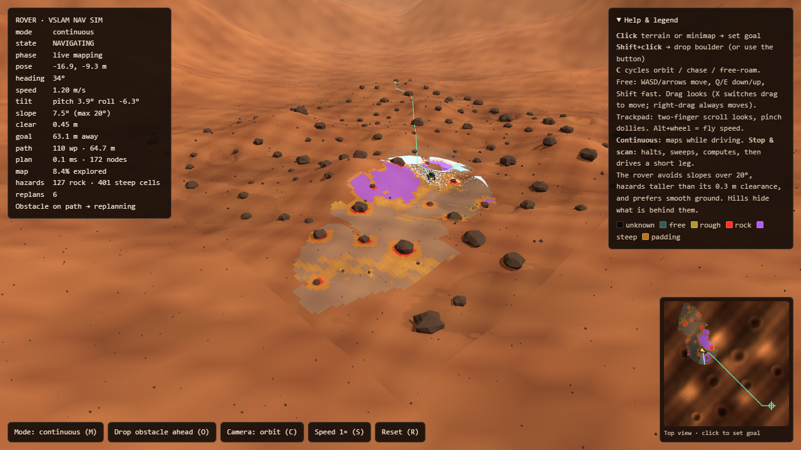
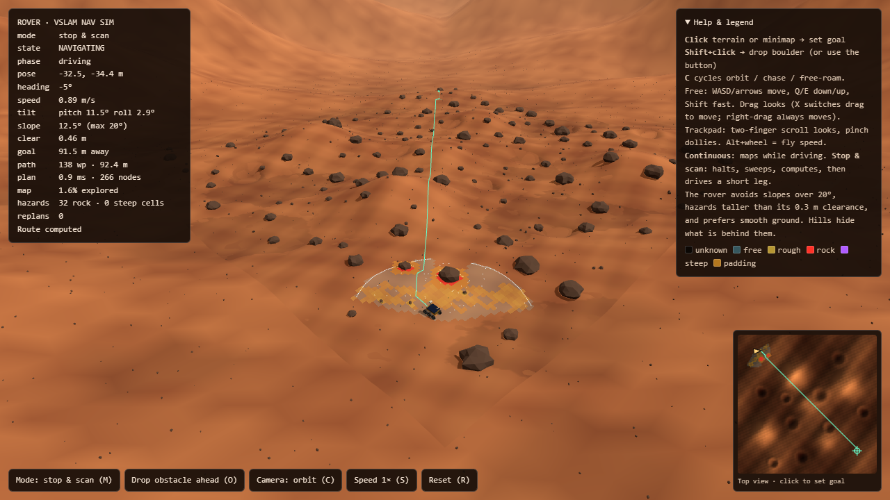

# Rover Nav Sim

A single-file, browser-based 3D simulator of an autonomous planetary rover that navigates a Mars-like surface **with no prior map and no GPS**. It is built with Three.js and was made to visualise the pipeline of a ROS2-style VSLAM navigation stack: perception → occupancy map → A\* planning → PID control.

> Open `index.html` in a browser. No build step, no install.

| Continuous mapping | Stop & scan: route computed | Stop & scan: mid-sweep |
|---|---|---|
|  |  |  |

---

## Contents

- [What it is](#what-it-is)
- [Quick start](#quick-start)
- [Controls](#controls)
- [The two operating modes](#the-two-operating-modes)
- [What the rover reasons about](#what-the-rover-reasons-about)
- [How it works](#how-it-works)
- [Mapping to a real ROS2 stack](#mapping-to-a-real-ros2-stack)
- [The HUD and map legend](#the-hud-and-map-legend)
- [Tuning reference](#tuning-reference)
- [URL parameters](#url-parameters)
- [Known limitations](#known-limitations)
- [Project layout](#project-layout)
- [Credits](#credits)

---

## What it is

The rover starts at one corner of a 90 × 90 m terrain with **no map**. It is given a goal. It must discover the world through a simulated camera, build an occupancy map as it goes, plan a path, drive it, and **replan whenever the map changes**.

The simulation is deliberately honest about how a real rover works:

- It only knows what its camera has seen. Unseen space is *unknown*, and the planner treats unknown space as passable (optimistic planning), then corrects itself when reality disagrees.
- Hills and boulders **block line of sight**, so ground behind them stays unknown until the rover gets a view.
- Slope steepness and obstacle height are inferred per cell, so the rover avoids more than just "walls": it avoids slopes it can't climb, rocks taller than its ground clearance, and rough ground.
- A second **stop & scan** mode shows the more realistic behaviour of a rover that halts, sweeps its sensor, computes, and then moves again.

The project's contribution is **integration and visualisation**, not new algorithms: it shows established ideas (occupancy grids, A\*, PID heading control, lidar/depth sensing) working together as one understandable pipeline.

## Quick start

**Option 1: just open it.** Double-click `index.html`. It loads Three.js from a CDN (jsDelivr), so you need an internet connection the first time.

**Option 2: serve it locally** (if your browser blocks something on `file://`):

```bash
# any static server works
python -m http.server 8000
# then visit http://localhost:8000
```

**Requirements:** a modern browser with WebGL 2 (Chrome, Edge, Firefox, Safari). A discrete or integrated GPU is recommended; the scene has a 4096² shadow map, ~110 boulders and a 300×300 terrain mesh.

## Controls

### Mouse / keyboard

| Input | Action |
|---|---|
| **Click** terrain | Set a new goal |
| **Click** the minimap | Set a new goal |
| **Shift + click** terrain | Drop a boulder from the sky at that point |
| `O` | Drop a boulder on the rover's planned route, ~5 m ahead |
| `M` | Toggle mode: continuous ↔ stop & scan |
| `C` | Cycle camera: orbit → chase → free-roam |
| `S` | Cycle simulation speed 1× → 2× → 4× |
| `R` | Reset the mission |
| `X` | (free camera only) toggle drag between *look* and *move* |

Shortcuts are ignored when Ctrl, Cmd or Alt is held, so browser shortcuts keep working. All of them also have on-screen buttons.

### Cameras

- **Orbit**: standard orbit controls around the terrain (drag to rotate, wheel to zoom, right-drag to pan).
- **Chase**: smoothly follows behind the rover.
- **Free-roam**: a fly camera with eased, glide-to-a-stop movement.

| Free-roam input | Action |
|---|---|
| `W A S D` / arrow keys | Move forward / left / back / right |
| `Q` / `E` | Move down / up |
| `Shift` | 3× speed boost |
| Drag | Look around (or move, if drag is set to *move*) |
| Right-drag | Always moves (slide sideways / up / down) |
| Two-finger scroll (trackpad) | Look around |
| Pinch (trackpad) | Dolly forward / back |
| Mouse wheel | Dolly forward / back |
| `Alt` + wheel | Change fly speed |

In free-roam mode `S` means "move back", so change simulation speed with the Speed button. The camera can't go below the terrain.

## The two operating modes

### Continuous (default)

The rover maps *while driving*. Its camera continuously reveals a ~100° field of view out to 10 m, and a radar-style sweep ping-pongs across that field. When newly revealed cells block the current path, the planner reruns immediately.

### Stop & scan

A more realistic perceive → think → act cycle:

1. **Drive** about 4 m along the current path.
2. **Brake** to a halt.
3. **Scan**: the camera head physically pans across a ~150° arc over 2.4 s. A glowing sweep fan and bright beam follow the terrain, lidar-style points light up on the surface (cyan = ground, red = rock, purple = too steep), and the occupancy map fills in as the beam passes.
4. **Process**: for ~1.3 s the status LED turns amber and expanding rings pulse out from the rover while the planner "computes".
5. **Plan** a new route with A\* and go back to step 1.

When the goal is first set (or changed) in this mode, the rover scans before it plans, because it has nothing to plan on until it has looked.

## What the rover reasons about

| Concern | How it is handled |
|---|---|
| **Unknown space** | Planned through optimistically; replanned as it is revealed |
| **Occlusion** | Rays are blocked by hills and rocks; hidden ground stays unknown |
| **Slope** | Cells steeper than **20°** are *lethal* (purple). Gentler slopes add cost and slow the rover down |
| **Ground clearance** | Boulders it can't climb are lethal (red). Low rocks (≤ ~0.3 m) and ridge crests are passable but add a roughness penalty (yellow). The HUD reports live clearance under the chassis (nominal 0.47 m) |
| **Rover footprint** | Lethal cells are padded (orange): 1 m around rocks, 0.5 m around steep ground |
| **Surface quality** | Slope, crest curvature and low rocks form a per-cell penalty; the planner multiplies step cost by `(1 + penalty)`, so smoother ground wins |
| **Terrain-following** | The rover's pitch and roll come from four height samples under the chassis and are shown in the HUD |
| **Dynamic obstacles** | A dropped boulder falls from the sky and is *invisible to the planner* until it lands and the camera sees it; this triggers a replan |

## How it works

Everything lives in `index.html` as one ES module. The main pieces:

### World and terrain

`H(x, z)` is an analytic height function: gentle dunes plus fine noise, nine craters (bowl and raised rim), five hills, and a distant mountain rim outside the playable area. The visible playable mesh (300×300) and a larger surroundings mesh (640 m) both sample it. The same function is used for rendering, rover placement, slope computation and the ground-truth ray tests, so the visuals and the "physics" can't disagree.

### Perception (simulated)

`castRay()` steps along a ray in 0.25 m increments. It tracks the highest angular elevation seen so far (a horizon test) to decide whether each sample is hidden behind terrain or a rock. For each newly visible cell it:

- marks rocks as lethal and inflates a padding radius around them,
- marks cells steeper than 20° as lethal,
- otherwise marks the cell free and records its roughness penalty.

It also emits fading lidar points (`THREE.Points`) so you can *see* what the sensor sees.

### Occupancy grid

180 × 180 cells at 0.5 m. Parallel typed arrays hold `known` (unknown / free / lethal), `kind` (rock vs. steep), `pen` (learned roughness) and `inflated` (footprint padding). The grid is drawn as a canvas texture draped over the terrain and reused for the minimap.

### Planner

8-connected **A\*** with a binary heap, an octile-distance heuristic, no diagonal corner-cutting, and a per-cell cost multiplier from the roughness penalty. Cells within 2 cells of the rover are allowed even if padded, so it can escape from a freshly discovered obstacle. If the goal cell is blocked it snaps to the nearest free cell. Plan time and expanded node count are shown in the HUD.

### Controller

A **PID** loop on heading error drives a differential-drive model. The rover aims at a lookahead waypoint on the path, turns in place when badly misaligned, eases in near the goal, and slows on slopes. Wheel spin rates are derived from left/right track speeds, so turning visibly spins the wheels at different rates.

### Rendering

Three.js with PCF soft shadows, hemisphere + directional lighting, fog, instanced pebbles and low rocks, and a procedurally modelled rover (rocker-bogie style frame, six lugged wheels, solar deck, mast, camera head, dish).

## Mapping to a real ROS2 stack

This sim is meant to be read alongside a ROS2 Jazzy / Gazebo Harmonic / RTAB-Map architecture. Each block here corresponds to a node you would run for real:

| In this simulator | Real-world equivalent |
|---|---|
| `castRay()` / `sense()` with simulated camera | Depth/stereo camera → RTAB-Map visual SLAM |
| Occupancy arrays (`known`, `kind`, `pen`) | `/map` occupancy grid (+ a traversability/cost layer) |
| `astar()` and `plan()` | Global planner (e.g. Nav2 planner server) |
| `drive()` PID | Local controller publishing `/cmd_vel` |
| Replan on blocked path | Costmap update triggering replanning |
| Stop & scan cycle | A rover that only perceives while stationary (common on real planetary missions) |

To go from simulation to a real robot, the intent is to replace `sense()` with the live map topic and keep the planner, controller and visualisation pipeline as they are.

## The HUD and map legend

The top-left telemetry panel shows: mode, state (`IDLE`, `PLANNING`, `NAVIGATING`, `NO PATH`, `ARRIVED`), phase (driving / scanning % / computing %), pose, heading, speed, **pitch/roll**, **slope under the rover (max 20°)**, **chassis clearance**, distance to goal, path length, plan time and nodes, % of map explored, hazard counts, and replan count. The panel border turns red on `NO PATH` and green on `ARRIVED`.

Map overlay colours (on the terrain and the minimap):

| Colour | Meaning |
|---|---|
| Dark tint | Unknown |
| Cyan tint | Known free ground |
| Yellow | Rough but traversable (penalty) |
| Red | Rock too tall to cross (lethal) |
| Purple | Slope too steep (lethal) |
| Orange | Footprint padding around lethal cells |

The **minimap** (bottom-right) is a top-down view with the explored map, the planned path, the goal, the rover, and the live sweep wedge. Click it to set a goal.

## Tuning reference

Constants are grouped near the top of the script:

| Constant | Default | Meaning |
|---|---|---|
| `SIZE`, `CELL` | 90 m, 0.5 m | World size and grid resolution |
| `FOV`, `RANGE` | 1.75 rad (~100°), 10 m | Continuous-mode camera |
| `ARC`, `SCAN_DUR`, `PROC_DUR`, `DRIVE_DIST` | 2.6 rad, 2.4 s, 1.3 s, 4 m | Stop & scan cycle |
| `SLOPE_MAX` | tan 20° | Steepest slope the rover will plan through |
| `CLR0` | 0.47 m | Chassis underside height |
| `VMAX`, `WMAX`, `ACC` | 1.6 m/s, 2.2 rad/s, 3 m/s² | Rover limits |
| `LOOK` | 1.2 m | Path lookahead distance |
| `KP`, `KI`, `KD` | 2.2, 0.1, 0.15 | Heading PID gains |
| `START`, `GOAL` | (-34, -34), (32, 30) | Default mission |

As with any real robot, the PID gains and clearance numbers are starting points and would need re-tuning against real hardware.

## URL parameters

| Parameter | Effect |
|---|---|
| `?mode=stop` | Start in stop & scan mode |
| `?ff=30` | Fast-forward 30 s of simulation before the first frame (handy for testing and screenshots) |

Combine them: `index.html?mode=stop&ff=5`.

## Known limitations

This is a visualisation and teaching tool, not a physics-accurate simulator.

- **Perception reads ground truth.** The camera is limited by range, field of view and line of sight, but it does not simulate sensor noise, depth error or feature tracking. There is **no pose drift and no loop closure**, so the rover always knows exactly where it is.
- **Kinematic, not dynamic.** No wheel slip, suspension, soil mechanics or torque limits; the rover can't get stuck.
- **Hard collision fallback.** If the map were wrong, a simple push-out collision against tall rocks keeps the rover from driving through them.
- **Grid planner only.** A\* produces a path of grid cells with no kinodynamic smoothing.
- **Linear low-rock handling.** Low rocks are climbable by design (≤ ~0.3 m) and only add a penalty.
- **Needs a network once**, to fetch Three.js from the CDN.
- Heavy for low-end GPUs; lower the shadow map size or terrain segments if needed.

Ideas for extension: simulated pose drift with loop-closure correction, noisy depth, a real `/map` feed over rosbridge, D\*-Lite for faster replanning, trajectory smoothing, slip and energy models, multiple rovers.

## Project layout

```
index.html        the whole simulator (HTML + CSS + JS module)
docs/             screenshots used in this README
README.md
```

Dependencies (loaded at runtime from jsDelivr, no install): [Three.js](https://threejs.org/) r170 and its `OrbitControls`.

## Credits

Built as a software demonstration for a college project on *Autonomous Rover Navigation for GPS-Denied Planetary Environments Using Visual SLAM* (Group 32, MET's Institute of Engineering, Dept. of Computer Engineering). Rendering by [Three.js](https://threejs.org/).
